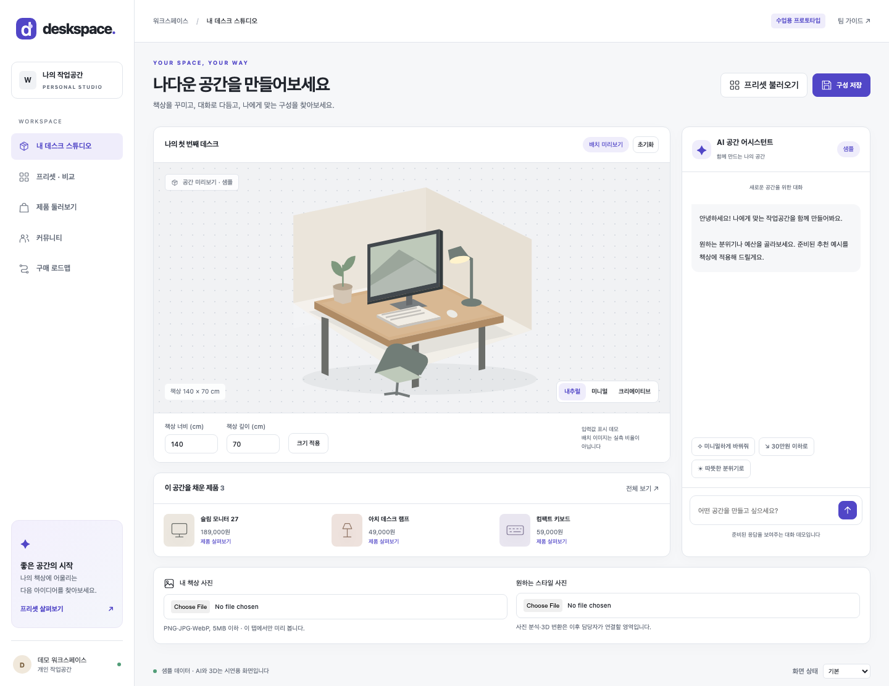

# Deskspace · 팀 프로토타입 스타터

데스크테리어 기능을 팀원별로 제작하기 위한 **공통 화면·스타일·샘플 상호작용**입니다. `Deskspace`는 화면 제작용 임시 이름입니다.



배포 없이 로컬 브라우저에서 실행합니다. 실제 AI, 3D 엔진, 가격 API, 계정, 데이터베이스는 연결하지 않았습니다. HTML·CSS·JavaScript는 이 스타터의 임시 구현 방식이며 최종 서비스 기술 스택 결정은 아닙니다.

## 바로 실행

저장소를 내려받거나 ZIP으로 다운로드한 뒤 **`index.html`을 브라우저로 여세요.** 패키지 설치·API 키·빌드가 필요 없습니다.

```sh
git clone https://github.com/Whatisjavadude/deskspace-prototype.git
cd deskspace-prototype
```

선택적으로 로컬 서버를 쓸 수 있습니다. 저장소 폴더에서 아래 명령을 실행한 뒤 `http://127.0.0.1:8000`을 엽니다.

```sh
python3 -m http.server 8000 --bind 127.0.0.1
```

## 지금 들어 있는 화면

| 화면 | 준비된 내용 | 팀원이 이어 만들 부분 |
|---|---|---|
| 내 데스크 스튜디오 | 공통 3열 배치, 책상 SVG 샘플, 사진 로컬 미리보기, 치수 입력, 스타일 선택 | 벽면 도면 조정, 배치 조작, 3D 샘플 교체 |
| AI 어시스턴트 | 준비된 3개 대화 시나리오, 스타일·제품 변경 | 조건별 추천 흐름, 대화 재조정, 국내 가격 비교 목업 |
| 프리셋·비교 | 프리셋 적용, 현재 구성 저장, 2개 비교 | 비교 항목·상태 상세화 |
| 제품 둘러보기 | 제품 카드, 분류, 구성 추가·제거, 너비 비교 예시 | 제품 상세와 적합도 설명 |
| 커뮤니티 | 샘플 피드, 좋아요 상태 | 게시물 상세·작성 화면 목업 |
| 구매 로드맵 | 순서 변경, 가상 가격 합계, 할인 안내 예시 | 단계·할인 안내 화면 목업 |

하단 **화면 상태**에서 기본·불러오는 중·내용 없음·오류를 볼 수 있습니다. 변경·저장·대화·사진은 현재 탭에서만 유지되며 새로고침하면 초기화됩니다. 사진은 서버에 업로드하지 않습니다.

## 팀 작업 시작

1. [화면·스타일 기준](docs/FOUNDATION.md)에서 공통 기준을 확인합니다.
2. [작업 분담·전달 안내](docs/HANDOFF.md)에서 맡을 영역과 완료 기준을 정합니다.
3. 기능 브랜치에서 해당 파일을 수정하고 Pull Request로 공유합니다.
4. `main`에는 함께 확인한 결과를 합칩니다. 담당자 이름과 일정은 팀이 정합니다.

화면 시안과 우선순위는 팀 검토용 제안입니다. 기능 목록에 나온 외부 서비스 이름은 참고 사례이며 코드·에셋을 복제하거나 API에 연결하지 않았습니다.

## 폴더

```text
index.html                 공통 메뉴·헤더·화면 진입점
styles/tokens.css          색상·글꼴·간격
styles/shell.css           공통 레이아웃·버튼·상태
styles/features.css        기능별 스타일 (접두사로 구분)
js/data.js                 샘플 데이터와 공유 상태
js/ui.js                   공통 UI·책상 샘플 SVG
js/app.js                  화면 전환
js/features/studio.js      책상 편집 영역
js/features/assistant.js   AI 대화 영역
js/features/presets.js     프리셋·비교
js/features/products.js    상품·적합도
js/features/community.js   커뮤니티
js/features/roadmap.js     구매 로드맵
docs/                      제작 기준·협업 안내·확인 결과
```

자료의 출처와 작업 범위는 [제작 기준](docs/FOUNDATION.md#근거와-상태), 확인 결과는 [QA 기록](docs/QA.md)에 있습니다.
